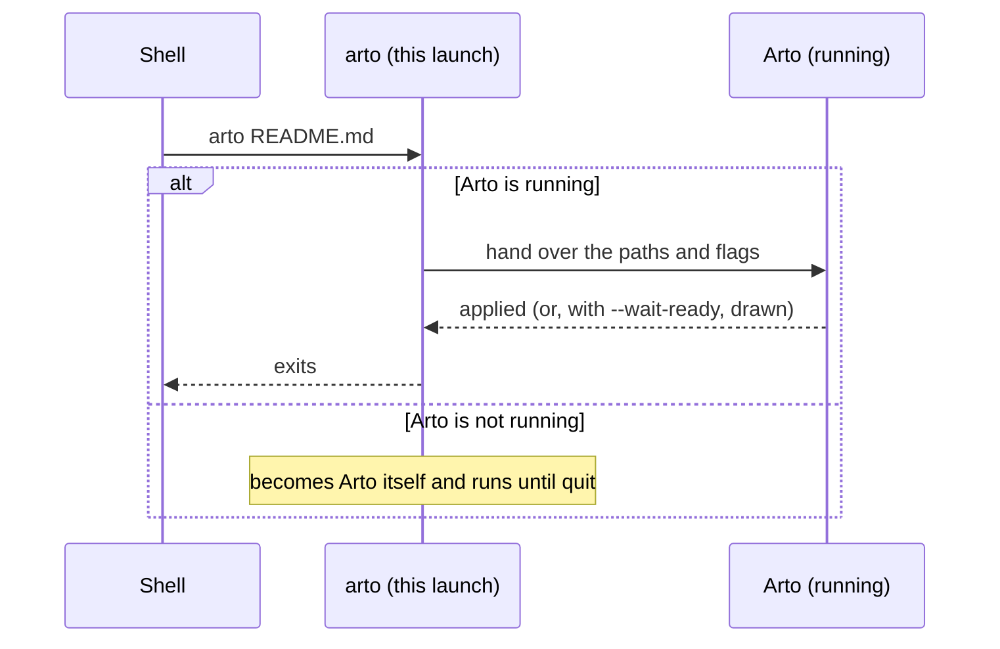

# CLI usage

Arto is a desktop application; the `arto` command is how you hand files to it
from a terminal, not a separate mode.

Homebrew, the `.deb` and Nix put `arto` on your `PATH`. The AppImage does not —
it is a single file, so run it by its own path, and everything below works the
same (it still needs WebKitGTK on the system; see
[Installation](./installation.md#linux)):

```sh
./arto_<version>_x86_64.AppImage README.md
```

On Windows, the copy to put on your `PATH` is the single binary from the
[releases] page rather than the installed one. Only the single binary is one
the shell waits for: with the installed copy the prompt comes back before
Arto has finished, so a redirect can be read half-written, `--wait-ready`
holds nothing, and no exit code reaches the script.

## Opening files

```sh
arto                     # Launch Arto (shows the welcome screen)
arto README.md           # Open a file
arto docs/               # Open a directory in the file explorer
arto file1.md file2.md   # Open several files, one window each
```

A path that is neither a file nor a directory is skipped. When no path is
left, the command acts as if it named none.

Arto runs as a **single instance**: if it is already running, the command hands
the request to the existing process rather than starting a second one.



| Flag | What it does |
| --- | --- |
| *(none)* | Opens where `fileOpen` in [`config.json`](./configuration.md#opening-files) says — by default, in the last focused visible window. Without arguments, shows or focuses an existing window, or opens one if there is none. |
| `--open=screen` | Opens on the screen the cursor is on, reusing a window already there on macOS; elsewhere it opens a new one. |
| `--open=new` | Always opens a new window. |
| `--behind` | Opens without activating Arto, leaving the keyboard focus where it is. |
| `--directory=DIR` | Shows DIR in the file explorer of the window the request lands in, beside the folders it already holds. A positional directory (`arto docs/`) does the same. |

`--behind` is for the hand-offs you did not stop to make — an editor or a
script putting a file in front of you while you keep typing:

```sh
arto --behind README.md
```

A window that is already open takes the file where it stands, without being
raised; a window that has to be created appears without Arto becoming the
active application. What the flag protects is the application you are working
in — when Arto is already the active application, a window it creates does
take the focus from the Arto window you were reading. Keeping the application
inactive is enforced on macOS; elsewhere a launch may still come forward.

Without any paths, `arto --behind` does nothing when Arto is already running:
bringing the app forward is exactly what the flag declines to do. Given
`--position`, `--size` or `--theme` as well, it changes the visible window
those apply to, still without bringing it forward; with no window visible it
still does nothing.

## Placing a window and waiting for it

These are for scripts — a screen capture that needs the window in a known
place, in a known theme, and drawn before it is taken:

```sh
arto --open=new --position=80,64 --size=1400,920 --theme=dark --wait-ready README.md
```

| Flag | What it does |
| --- | --- |
| `--position=X,Y` | Puts the window's top-left corner at these screen coordinates, in logical pixels. Negative values reach a display left of or above the main one. |
| `--size=WIDTH,HEIGHT` | Gives the window this size, in logical pixels. |
| `--theme=THEME` | Shows the window in `auto`, `light` or `dark`, whatever the preferences say. |
| `--wait-ready` | Returns only once the window has drawn what it was given. |

`--position`, `--size` and `--theme` apply to the window `--open` selects,
whether it is reused or created, and also when no path is named — `arto
--size=1400,920` resizes the window Arto would show. A flag left out leaves
that part of the window as it is.

`--wait-ready` applies when Arto is already running and the command hands its
request over. Given several files, each in a window of its own, it returns
once the first of those windows has drawn, not all of them. A command that starts Arto itself becomes Arto and runs until
it is quit, with or without the flag.

A command that handed its request over exits with:

| Status | When |
| --- | --- |
| `0` | The request was applied — and, with `--wait-ready`, the window drew it. A path skipped as missing does not change the status. |
| `1` | The running Arto refused the request or did not answer, or `--wait-ready` was given and the window did not draw in time. |

## Rendering a standalone page

`arto page` renders a Markdown file into a single HTML file carrying Arto's
stylesheet and rendering code inline, so it opens in any browser without the
app — Mermaid diagrams and math included.

```sh
arto page README.md > README.html
arto page --output out.html docs/guide.md
arto page --theme dark notes.md
```

The page follows your `config.json` — its default theme and GitHub themes,
its typography, and its choices about what the renderer reads out of the
Markdown. The theme is the configured default, not the one a window is
showing or restored. `--theme` and `--no-auto-link-urls` override a setting
for one run, `--config FILE` reads another file, and `--no-config` starts
from the built-in defaults. A missing `config.json` means the defaults; one
that cannot be read or parsed stops `arto page` with an error and exit
status `1`, and `--no-config` gets past it. The macOS Quick Look preview reads the same
configuration when its sandbox allows.

The page ships with a Content-Security-Policy that blocks any script embedded
in the Markdown and anything fetched from elsewhere: an image the document
names by URL shows as its alt text, and a video as the link it holds, where
the app would show them. Pass `--no-csp` only for input you trust; the page
then loads them, and no longer blocks a script the Markdown carries.

The same command is available as a standalone `arto-page` binary for machines
without the app.

[releases]: https://github.com/arto-app/Arto/releases
