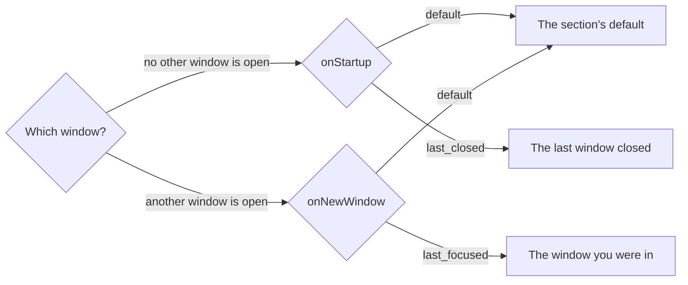

# Configuration

Preferences live in `config.json` in the app config directory:

| Platform | Location |
| --- | --- |
| macOS | `~/Library/Application Support/arto/config.json` |
| Linux | `~/.config/arto/config.json` (or `$XDG_CONFIG_HOME/arto/`) |
| Windows | `%APPDATA%\arto\config.json` |

The Preferences window writes this file, and it can be edited by hand as
well: Arto reads it again when it is saved, so a change takes effect without
a restart. Keybindings are kept apart, in `mappings.json` next to it — see
[Keybindings](./keybindings.md).

A save never leaves half a file behind. When `config.json` or
`mappings.json` is a symlink — kept in a dotfiles repository and linked into
place — the file it points to is the one written, its permissions are kept,
and the link stays a link.

Every section may be left out and takes its defaults. Most keys inside a
section may be left out too; the few a section must have once it is written
are the ones the [schema](#editor-support) marks as required.

Without a `config.json`, Arto uses the defaults. A file that cannot be read
or parsed — a typo, a missing required key, a value of the wrong type — is
not read at all, and nothing in it applies: at launch Arto starts with the defaults, for `config.json` and `mappings.json`
alike, and while it runs it keeps the configuration it had until the file is
saved again in a shape it can read.

| Key | What it holds |
| --- | --- |
| `language` | The language of Arto's own words — [Interface language](#interface-language) |
| `fileOpen` | Which window a file handed to Arto opens in — [Opening files](#opening-files) |
| `directory` | Where the file explorer starts — [Opening files](#opening-files) |
| `theme` | Light, dark and which of GitHub's themes — [Theme](#theme) |
| `markdown` | What the renderer reads out of the Markdown — [Markdown](#markdown) |
| `typography` | How the text is set — [Typography](#typography) |
| `reading` | Reading time and the marks of what changed — [Reading](#reading) |
| `sidebar` | The panel and the margin trace — [Panel](#panel) |
| `windowPosition`, `windowSize`, `zoom` | Where a window opens, how large, at what zoom — [Windows](#windows) |
| `lenses` | What a document can be looked at through — [Lenses](./lenses.md) |

## Startup and new windows

Several sections decide a value the same way, with two keys beside the
default they hold:

| Key | Values |
| --- | --- |
| `onStartup` | `default` — the section's default; `last_closed` — what the last window closed had |
| `onNewWindow` | `default` — the section's default; `last_focused` — what the window you were in has |



`onStartup` answers for a window opened while no other is — at launch, or
once every window has been closed — and `onNewWindow` for one opened beside
another. Both default to `default`.

## Interface language

`language` is `auto`, `en` or `ja`. `auto` follows the system and falls back
to English when Arto has no translation for the system's language. Only
Arto's own words change — menus, preferences, messages; documents are never
translated. The change takes effect after a restart, which the Appearance
pane offers.

## Opening files

`fileOpen` says which window a file handed to Arto — from the command line,
the Finder or Explorer — opens in:

| Value | Opens in |
| --- | --- |
| `last_focused` *(default)* | The last focused visible window |
| `current_screen` | A visible window on the screen the cursor is on, on macOS; elsewhere, a new window on that screen |
| `new_window` | Always a new window |

`arto --open` overrides it for one command; see [CLI usage](./cli.md).

`directory` says what the file explorer holds besides the places you added:

| Key | What it sets | Default |
| --- | --- | --- |
| `defaultDirectory` | A folder the first window starts in, or `null` for the places alone | `null` |
| `onStartup` | See [Startup and new windows](#startup-and-new-windows) | `default` |

A new window takes its folders from the command that opened it: New Window
starts with the places, Duplicate Window brings this window's folders too.

## Theme

| Key | What it sets | Default |
| --- | --- | --- |
| `defaultTheme` | `auto`, `light` or `dark`; `auto` follows the system | `auto` |
| `lightTheme` | The GitHub theme painted in light mode | `light` |
| `darkTheme` | The GitHub theme painted in dark mode | `dark` |
| `onStartup`, `onNewWindow` | See [Startup and new windows](#startup-and-new-windows) | `default` |

The GitHub themes are `light`, `light_high_contrast`, `light_colorblind` and
`light_tritanopia` for light mode, and `dark`, `dark_dimmed`,
`dark_high_contrast`, `dark_colorblind` and `dark_tritanopia` for dark mode.

## Markdown

`markdown` decides what the renderer reads out of a document beyond
GitHub's dialect, which is always read. The app, `arto page` and the Quick
Look preview read the same section, so a document is read the same way in
all of them; what a standalone page leaves out is in
[CLI usage](./cli.md#rendering-a-standalone-page).

| Key | When on | Default |
| --- | --- | --- |
| `autoLinkUrls` | A bare URL becomes a link | on |
| `math` | `$…$` and `$$…$$` are formulas | on |
| `wikiLinks` | `[[target]]` and `[[target\|label]]` link to another document | on |
| `superscript` | `^text^` is superscript | on |
| `subscript` | `~text~` is subscript | on |
| `definitionLists` | Definition lists, as PHP Markdown Extra and mdBook write them | on |
| `headingAttributes` | A trailing `{#id .class}` on a heading gives its id and classes | on |
| `smartPunctuation` | Quotes, dashes and ellipses take their typographic forms | on |
| `cjkEmphasis` | Emphasis pairs against East Asian punctuation, so `**強調。**` is emphasized | on |
| `headingPermalinks` | Each heading carries a `#` link, as on GitHub | off |

A change here applies to a document the next time it is rendered — when it
changes on disk, is reloaded, or is opened again — not to one already on
screen.

Turn one off when a document means the characters literally — `math` for a
document full of shell variables, `subscript` for one that writes `~5
minutes`.

`rawHtml` decides what becomes of HTML written into the Markdown:

| Value | Raw HTML |
| --- | --- |
| `filter` *(default)* | Passes through, except the tags GitHub filters (`<style>`, `<script>`, `<iframe>` and their kin), event handler attributes such as `onerror`, and `javascript:` URLs; other attributes, an inline `style` among them, are kept. A document whose HTML cannot be filtered whole is shown with all of its raw HTML escaped instead |
| `allow` | Passes through untouched |
| `escape` | Shows as written, so the document shows its own markup |

## Typography

How a document's text is set lives in `typography`, and the Reading pane of
the Preferences window sets the same keys:

```json
{
  "typography": {
    "measure": 60,
    "lineHeight": 1.5,
    "fontFamily": "sans",
    "customFontFamily": "",
    "fontSize": 16,
    "cjkFontLanguage": "auto"
  }
}
```

| Key | What it sets | Values |
| --- | --- | --- |
| `measure` | The longest a line of text runs, in em | 30–100 |
| `lineHeight` | The height of a line as a multiple of the text size | 1.2–2.2 |
| `fontFamily` | The face the text is set in | `sans`, `serif`, `mono`, `custom` |
| `customFontFamily` | The CSS `font-family` used with `custom` | e.g. `"Source Han Serif", serif` |
| `fontSize` | The size of the text in px; headings and code follow it | 12–24 |
| `cjkFontLanguage` | Whose faces CJK characters are drawn in | `auto`, `ja`, `zh-Hans`, `zh-Hant`, `ko` |

The defaults are the page as GitHub sets it. A measure of 40em holds about 40
Japanese characters or about 80 Latin ones, whichever script the document is
in. Code keeps its monospace face whatever is chosen.

`cjkFontLanguage` says whose faces Chinese,
Japanese and Korean characters are drawn in: `ja`, `zh-Hans`, `zh-Hant` or
`ko` name that language's faces after the Latin ones in the `sans`, `serif`
and `mono` stacks. `auto` names none and leaves the face to the system, as
GitHub does. It picks faces only — the language documents are read as, which
a screen reader follows, is left alone — and a `custom` face is used as
written.

The system faces (`-apple-system`, `ui-monospace` and their kin) leave the
stack whenever a CJK font language is chosen. On macOS that
moves Latin text from SF to Helvetica in `sans` and from SF Mono to Menlo in
`mono`. Other systems keep their Latin faces.

A value outside its range is drawn at the nearest end of it. A
`customFontFamily` is a comma-separated list that may hold only letters,
digits, spaces, quotes and `_ , - . +`, with any name holding more than
letters, digits, `_` and `-` in quotes; anything else leaves the text in the
`sans` face.

The full-width button in the header still lets one window ignore the measure,
and a printed page always runs the width of the paper. Zoom is separate: it
enlarges the whole page, images included, where `fontSize` sets only the text.
`arto page` and the Quick Look preview set the text the same way.

## Reading

| Key | What it sets | Default |
| --- | --- | --- |
| `showTime` | Whether the header shows how long the document takes to read, and how long is left | `true` |
| `wordsPerMinute` | Reading speed for scripts written in words | `230` |
| `charactersPerMinute` | Reading speed for Chinese, Japanese and Korean | `500` |
| `minMinutes` | A document shorter than this many minutes shows no reading time | `3` |
| `showChanges` | Whether what changed since the document was last read is marked: a line beside each block added or rewritten, a hairline where text was taken out, a dot on the headings they fall under. To compare, Arto keeps a copy of each document's source as last read, with the app's data; turning this off stops new copies being kept but does not remove those already kept. A document too large to copy is shown without changes, and once the copies outgrow their space the ones read longest ago go first | `true` |
| `ignoreWhitespaceChanges` | Whether a line whose words are only spaced differently counts as unchanged | `true` |

## Panel

`sidebar` sets the panel — the file explorer, the documents read and the
starred ones — and the margin trace, the documents read before this one left
at the edge of the page.

| Key | What it sets | Default |
| --- | --- | --- |
| `defaultPinned` | Whether the panel starts pinned beside the document | `false` |
| `defaultWidth` | Its width, in px | `280` |
| `defaultShowAllFiles` | Whether the explorer lists files other than Markdown | `false` |
| `defaultZoomLevel` | The zoom of the panel's own text | `1.0` |
| `pinOn` | `click` pins the panel; `double_click` pins it, and a single click brings it out until the pointer leaves | `click` |
| `peekOnHover` | Whether resting the pointer on the rail brings the panel out | `true` |
| `onOpen` | `keep_open` leaves the panel out after a document is opened from it; `close_panel` puts it away | `keep_open` |
| `minContentWidth` | The width, in px, the document keeps before the panel and the trace give way | `640` |
| `recentTrace` | When the trace is drawn: `never`, `hidden_when_sidebar` (not while the panel is out) or `always` | `hidden_when_sidebar` |
| `recentTraceCount` | How many documents the trace names | `6` |
| `onStartup`, `onNewWindow` | See [Startup and new windows](#startup-and-new-windows) | `default` |

## Windows

| Key | What it sets | Default |
| --- | --- | --- |
| `windowSize.defaultSize` | A new window's width and height | 1000 × 800 px |
| `windowPosition.defaultPositionMode` | `coordinates` puts a new window at `defaultPosition`; `mouse` puts it at the cursor | `coordinates` |
| `windowPosition.defaultPosition` | Where a new window opens within the screen's usable area; 50 % × 50 % centres it | 50 % × 50 % |
| `windowPosition.positionOffset` | How far, in px, a new window steps aside from one already where it would open | 20 × 20 |
| `zoom.defaultZoomLevel` | The zoom a window opens at; `1.0` is 100 % | `1.0` |

A width, height or position is written with its unit, in px or as a
percentage of the screen:

```json
{
  "windowSize": {
    "defaultSize": {
      "width": { "value": 1000, "unit": "pixels" },
      "height": { "value": 80, "unit": "percent" }
    }
  }
}
```

Each of the three also takes `onStartup` and `onNewWindow`; see
[Startup and new windows](#startup-and-new-windows).

## Editor support

The file names its JSON Schema on its first line:

```json
{
  "$schema": "https://raw.githubusercontent.com/arto-app/Arto/main/schemas/config.schema.json"
}
```

An editor that reads JSON Schema — VS Code, or any editor running
`vscode-json-languageserver` — then completes every key and value, shows what
each one does on hover, and marks a value Arto would reject. It also marks a
key Arto does not know: Arto ignores such a key and drops it the next time it
saves the file, so a misspelled one is worth fixing while it is still there.

Arto adds the line itself the first time it saves the file. A file written
before that can have it added by hand; a `$schema` that points somewhere else
is kept as it is.

The schema describes Arto as it is on `main`, so a key added since the
release you run is offered before that release reads it. The schema itself
is generated from the configuration types, at
[`schemas/config.schema.json`](../../schemas/config.schema.json).
