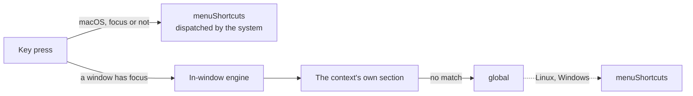

# Keybindings

Shortcuts live in `mappings.json`, next to `config.json` in the app config
directory. Preferences ships Default, Vim and Emacs presets, plus Clear, which
removes every binding so you can start from nothing; this document is for
editing the file directly.

Without a `mappings.json`, Arto uses the Default preset. A file that exists
replaces the preset whole — a binding it leaves out is not bound — and Arto
reads it again when it is saved, so an edit takes effect without a restart.
A lens's own `shortcut` lives with the lens in `config.json` (see
[Lenses](./lenses.md#configuring-a-lens)) and is bound on top of this file,
Clear included, unless the file already binds the same keys.

## The file

Each section is a list of bindings, each binding a `key` and the `action` it
runs:

```json
{
  "menuShortcuts": [
    { "key": "Cmd+o", "action": "file.open" }
  ],
  "global": [
    { "key": "j", "action": "scroll.down" },
    { "key": "g g", "action": "scroll.top" }
  ],
  "sidebar": [
    { "key": "Enter", "action": "cursor.open" }
  ]
}
```

| Section | Bindings that answer |
| --- | --- |
| `menuShortcuts` | Through the menu; see [Two kinds of shortcut](#two-kinds-of-shortcut) |
| `global` | Anywhere in a window, unless the context's own section binds the same keys; not while typing in a text field other than find and the palette |
| `content` | While the document has focus |
| `sidebar` | While the panel has focus, whichever of its faces is showing |
| `search` | While the find field has focus |
| `palette` | While the command palette is open |
| `contents` | While the list of headings is open |

Adding a binding in **Preferences → Keybindings** offers every action, and
the file it writes names each by the id used here; the [Default preset] shows
the ids of the common ones.

An entry whose key cannot be read or whose action Arto does not know is
skipped, and the rest of the file still applies. A file that is not valid
JSON, or whose entries are not shaped as above, is not read at all: at
launch Arto starts with the default configuration — `config.json` included —
and while it runs it keeps the shortcuts it had until the file is saved
again in a shape it can read.

## Writing a key

A chord is any modifiers joined to a key with `+`; a sequence is chords
separated by spaces, pressed one after another:

| Written | Pressed |
| --- | --- |
| `j` | J |
| `Shift+j` | Shift and J |
| `Cmd+Shift+t` | Cmd, Shift and T |
| `g g` | G, then G again |
| `Ctrl+x Ctrl+c` | Ctrl+X, then Ctrl+C |

- Modifiers are `Cmd` (or `Command`, `Meta`), `Ctrl` (or `Control`), `Alt`
  (or `Option`) and `Shift`. `Cmd` is `Ctrl` on Linux and Windows, so one file
  serves every platform.
- A key is one ASCII letter, digit or symbol other than `+`, or a named key: `Enter`, `Escape`,
  `Tab`, `Space`, `Backspace`, `Delete`, the arrows (`ArrowUp` or `Up`, …),
  `Home`, `End`, `PageUp`, `PageDown` and `F1` to `F12`. Symbols that are
  awkward in a chord have names: `Equal`, `Minus`, `Comma`, `Period`,
  `Slash`, `Backslash`, `Semicolon`, `Quote`, `Backquote`, `BracketLeft` and
  `BracketRight`.
- A letter means the character the keyboard types, so `j` is the key that
  types J whatever the layout. Case does not matter: `J` is `j`, and Shift is
  written as `Shift`.

## Two kinds of shortcut



**Menu shortcuts** (`menuShortcuts`) are single chords (`Cmd+o`), each keyed
by a menu action such as `file.open`. On macOS they are native menu
accelerators, shown in the menu bar and dispatched by the system, so the
actions that need no window — `Cmd+n` opening one, say — work with every
window closed. On Linux and Windows the menu is drawn in the window's header,
and the in-window engine handles menu shortcuts like any other keybinding.

**Keybindings** (`global` and the per-context sections) are handled by the
in-window engine. They support chord sequences (vim's `g g`) and per-context
behaviour, but only fire while a document window has focus. A context's own
binding wins over a `global` one for the same keys. In `search` and
`palette`, which are fields being typed into, a key without a modifier is
typed rather than looked up in `global`; a chord with a modifier still
reaches `global`.

The same action may appear in both: `file.open` can be a native `Cmd+o` menu
shortcut *and* have an in-window keybinding.

## Migrating an older `mappings.json`

Files written before `menuShortcuts` existed still load unchanged.
Menu-backed shortcuts under `global` (`Cmd+o`, `Cmd+n`) keep working through
the engine, but to get native menu accelerators, move those entries into a
`menuShortcuts` section — or re-apply a preset from Preferences.

[Default preset]: ../../crates/arto-keybindings/src/presets/default.json
