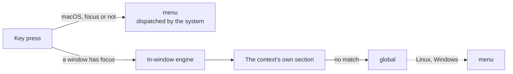

# Keybindings

Shortcuts live in `keys.toml`, next to `config.json` in the app config
directory. The file names a preset to start from and says how your shortcuts
differ from it; this document is for editing it directly.

Arto ships the Default, Vim and Emacs presets, and `none`, which binds
nothing so you can start from scratch. Without a `keys.toml`, Arto uses the
Default preset. Arto reads the file again when it is saved, so an edit takes
effect without a restart. A lens's own `shortcut` lives with the lens in
`config.json` (see [Lenses](./lenses.md#configuring-a-lens)) and is bound on
top of these shortcuts, `none` included, unless they already bind the same
keys.

## The file

```toml
preset = "vim"

[menu]
"Cmd+p" = "none"

[global]
"Ctrl+n" = "scroll.down"
"Ctrl+p" = "scroll.up"

[sidebar]
"Enter" = "cursor.open"
```

`preset` is `default`, `vim`, `emacs` or `none`; left out, it is `default`.
Each table is a section of the preset, and each entry binds keys to the
action they run. An entry for keys the section already binds replaces that
binding, and one for keys it does not bind adds one; `"none"` takes the keys
away, so they do nothing there. Everything the file does not mention stays as
the preset has it, so a file holds only your own changes, and a preset that
changes in a later version of Arto reaches you.

| Section | Bindings that answer |
| --- | --- |
| `menu` | Through the menu; see [Two kinds of shortcut](#two-kinds-of-shortcut) |
| `global` | Anywhere in a window, unless the context's own section binds the same keys; not while typing in a text field other than find and the palette |
| `content` | While the document has focus |
| `sidebar` | While the panel has focus, whichever of its faces is showing |
| `search` | While the find field has focus |
| `palette` | While the command palette is open |
| `contents` | While the list of headings is open |

The presets are written as this file is, each section in full: [Default],
[Vim] and [Emacs] show every action id they use. Adding a binding in
**Preferences → Keybindings** offers every action.

An entry whose key cannot be read or whose action Arto does not know is
skipped, and the rest of the file still applies. A file that is not valid
TOML, that names a preset or a section Arto does not have, or whose entries
are not strings, is not read at all: at launch Arto starts with the default
configuration — `config.json` included — and while it runs it keeps the
shortcuts it had until the file is saved again in a shape it can read.

## Changing them in Preferences

**Preferences → Keybindings** shows which preset is in use and how many
changes the file makes to it. Choosing a preset replaces every shortcut with
the preset's; choosing the one in use puts back all of its shortcuts.

The shortcuts are listed action by action, each with the keys that run it,
and can be filtered by keys, by an action's name or by its group. Keys added
to an action are bound where it works, without choosing a section: the first
single chord held with Cmd or Ctrl added to an action the menu offers becomes
its menu shortcut, and other keys go to `global`, or to the section of the
list or field the action works in. Keys that ran another action there move to
this one, and so do keys the menu used for another action, since on macOS the
menu would take them first; the form says which action loses them. Keys
taken away are
taken away wherever they ran the action, and keys that run it in some
sections only say where. An action whose keys differ from the preset is
marked, and can be put back to the preset's keys.

Listed by section instead, the shortcuts are edited section by section, as
the file holds them.

Each change is written into `keys.toml` at once, as a change to the preset:
entries that still hold are left as they were written, comments included,
and an entry that no longer differs from the preset is taken out. A
`keys.toml` that cannot be read is not written over until it is fixed.

## Writing a key

A chord is any modifiers joined to a key with `+`; a sequence is chords
separated by spaces, pressed one after another:

| Written | Pressed |
| --- | --- |
| `j` | J |
| `Shift+j` | Shift and J |
| `Cmd+Shift+t` | Cmd, Shift and T |
| `g g` | G, then G again |
| `Ctrl+x Ctrl+c` | Ctrl+X, then Ctrl+C |

- Modifiers are `Cmd` (or `Command`, `Meta`), `Ctrl` (or `Control`), `Alt`
  (or `Option`) and `Shift`. `Cmd` is `Ctrl` on Linux and Windows, so one file
  serves every platform.
- A key is one ASCII letter, digit or symbol other than `+`, or a named key: `Enter`, `Escape`,
  `Tab`, `Space`, `Backspace`, `Delete`, the arrows (`ArrowUp` or `Up`, …),
  `Home`, `End`, `PageUp`, `PageDown` and `F1` to `F12`. Symbols that are
  awkward in a chord have names: `Equal`, `Minus`, `Comma`, `Period`,
  `Slash`, `Backslash`, `Semicolon`, `Quote`, `Backquote`, `BracketLeft` and
  `BracketRight`.
- A letter means the character the keyboard types, so `j` is the key that
  types J whatever the layout. Case does not matter: `J` is `j`, and Shift is
  written as `Shift`.

## Two kinds of shortcut



**Menu shortcuts** (`menu`) are single chords (`Cmd+o`), each keyed
by a menu action such as `file.open`. On macOS they are native menu
accelerators, shown in the menu bar and dispatched by the system, so the
actions that need no window — `Cmd+n` opening one, say — work with every
window closed. On Linux and Windows the menu is drawn in the window's header,
and the in-window engine handles menu shortcuts like any other keybinding.

**Keybindings** (`global` and the per-context sections) are handled by the
in-window engine. They support chord sequences (vim's `g g`) and per-context
behaviour, but only fire while a document window has focus. A context's own
binding wins over a `global` one for the same keys. In `search` and
`palette`, which are fields being typed into, a key without a modifier is
typed rather than looked up in `global`; a chord with a modifier still
reaches `global`.

The same action may appear in both: `file.open` can be a native `Cmd+o` menu
shortcut *and* have an in-window keybinding.

## Moving from `mappings.json`

Arto kept shortcuts in `mappings.json`, every one of them, before
`keys.toml`. While there is no `keys.toml`, Arto reads `mappings.json` as it
did, and the first change saved from Preferences writes `keys.toml` from it,
as changes to the preset it is closest to. Once `keys.toml` exists,
`mappings.json` is no longer read; Arto leaves it where it is.

[Default]: ../../crates/arto-keybindings/src/presets/default.toml
[Vim]: ../../crates/arto-keybindings/src/presets/vim.toml
[Emacs]: ../../crates/arto-keybindings/src/presets/emacs.toml
