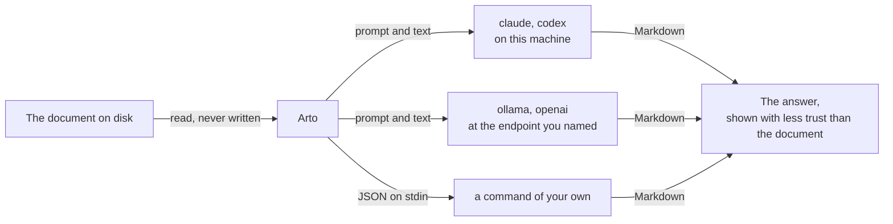
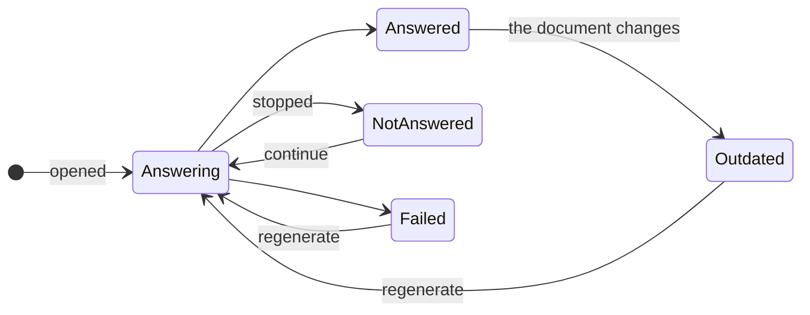

# Lenses

A lens is something you look at a document through: a command-line agent, a
language-model server or a command of your own is handed the document's
source, and its answer is shown with the document — a translation in the
document's places, a summary on request, a note beside each paragraph. Arto never writes an
answer into the file; what a command of your own, or an agent allowed
`shell`, does on its own is outside that — see
[What an agent is allowed](#what-an-agent-is-allowed).

Arto reaches out to nothing on its own. A lens runs only when you open it,
and only what you configured it with is handed the text it looks at: a
program on your machine, or the server you named. Whether the text leaves the
machine is up to what you chose — an Ollama server on your own machine keeps
it there.



## Three ways to show an answer

| `display` | The agent runs | The answer is shown |
| --- | --- | --- |
| `page` | once, on the whole document | in the document's places, block by block from the top as it is written — a translation |
| `popover` | once, on the whole document or on one block | from the header for the document, beside the block for a block — a summary |
| `annotate` | once per block, with the blocks around it as context | beside each block, behind a mark in its margin — a gloss, an explanation |

A `page` answer is paired with the document block by block, in order: the
answer's first block takes the place of the document's first, and so on, so
the page reads as the answer from the top down while the rest is still the
document. The original of an answered block can be seen without leaving the
answer, and the header counts the blocks answered. An answer that keeps the
document's structure — as a translation does — pairs cleanly; one that
merges or splits blocks still shows, but is paired with the wrong originals.

A page lens with `unit: "block"` hands the document over one top-level block
at a time instead — code, diagrams and formulas stay as written — and shows
each answer once every block above it has one, so the page still turns over
from the top down. Every block keeps its place whatever the model does; no
run sees the rest of the document.

Any number of page lenses can be open, but one takes the page at a time: the
header chooses which, or **Original**, the document as written, and switching
is immediate since their answers are kept. The other displays only add to
the page, so any number of them can show beside it and beside each other —
summarize a translated page and the translation stays. A block marked by
several lenses shows each lens's answer under the lens's label. A lens
opened again replaces its own earlier answer.

An answer is shown with less trust than the document itself: raw HTML in it
is shown as written, whatever [`markdown.rawHtml`] allows, and nothing in it
is fetched from another host — an image from elsewhere shows as its alt text.

## What is kept

What a lens answered about a whole document is kept on disk, with the app's
data rather than its caches, and a document opens with the lenses it had open
over it when it was last read — after a restart too — showing what they
answered without asking again. Nothing is asked again until you choose to; a
lens over a document it has no answer for asks at once. The answers kept
have a limit on the space they take, past which those used longest ago are
dropped, so a lens over a document not read for a long time may ask again.

A lens opened on a block is not kept: it closes when it is hidden, when the
document is rendered again, or when the window closes.



- **Outdated** — the document changed since the answer, on disk while it is
  open or between readings. The old answer stays, marked, and the lens menu
  offers to regenerate it — just the outdated blocks for a lens asked a block
  at a time (`annotate`, or `page` with `unit: "block"`), the whole answer for
  one asked about the whole document.
- **Not answered** — the lens was stopped before it finished. The lens menu
  offers to continue it.
- **Failed** — see [When a run fails](#when-a-run-fails).

To ask a lens again about everything, whatever it answered before,
regenerate it from the lens menu, or choose **Regenerate all** in the
right-click menu. Hiding a lens takes its answer off the page but keeps the
lens in the header, to be shown again at once, and the document opens with it
hidden. **Forget …'s answers** in the right-click menu removes a lens and its
answers from a document; it asks twice, since it cannot be undone.

## Configuring a lens

Lenses are edited in **Preferences → Lenses**, which can start a lens from a
recipe — translate the page, a translation beside each block, summarize,
explain the terms, critique, explain a block — with its prompt and display
written already. They are kept in `lenses` in `config.json`, a list, which
can be edited by hand as well: Arto reads the file again when it is saved, so
the menus offer an edited lens without a restart, in the order the list
gives. Name an `agent` Arto knows and give it a `prompt`:

```json
{
  "lenses": [
    {
      "id": "translate-ja",
      "label": "Translate to Japanese",
      "display": "page",
      "agent": "claude",
      "model": "sonnet",
      "prompt": "Translate the text into Japanese. Keep its structure exactly and translate the prose only. Write the translated document and nothing else."
    },
    {
      "id": "translate-ja-local",
      "label": "Translate to Japanese (local)",
      "display": "page",
      "agent": "ollama",
      "model": "qwen3:4b-instruct",
      "prompt": "Translate the text into Japanese. Keep its structure exactly and translate the prose only. Write the translated document and nothing else."
    },
    {
      "id": "summarize",
      "label": "Summarize",
      "display": "popover",
      "agent": "openai",
      "endpoint": "https://api.openai.com/v1",
      "model": "gpt-5-mini",
      "prompt": "Summarize the text in a few sentences."
    }
  ]
}
```

| Field | Meaning | Default |
| --- | --- | --- |
| `id` | Names the lens; must be unique | — |
| `label` | What the menus and the header call it | — |
| `display` | `page`, `popover` or `annotate` | — |
| `agent` | `claude`, `codex`, `ollama` or `openai` | — |
| `model` | The model the agent uses; required for `ollama` and `openai` | the agent's own |
| `prompt` | What the agent is asked to do with the text; without one the agent is handed the text alone | — |
| `program` | `claude`, `codex`: where the program is, when it is not found on its own | found on `PATH` and in the usual install directories |
| `endpoint` | `ollama`: the server's address; `openai`: the base URL, the part before `/chat/completions` | `ollama`: `http://127.0.0.1:11434`; `openai`: `https://api.openai.com/v1` |
| `system` | `ollama`, `openai`: the system prompt sent with every request | — |
| `contextLength` | `ollama`: the context the model is loaded with, in tokens | sized to each request |
| `apiKeyCommand` | `ollama`, `openai`: a program and its arguments that print the API key, in place of the stored one | — |
| `allow` | `claude`, `codex`: what the agent may do beyond reading the text it is handed — `webSearch`, `readFiles`, `shell`; see [What an agent is allowed](#what-an-agent-is-allowed) | nothing |
| `command` | Instead of an `agent`: a program and its arguments, run as given | — |
| `context` | `annotate`: blocks on each side handed over as context, at most 20 | `2` |
| `concurrency` | `annotate`, and `page` with `unit: "block"`: runs in flight at once, 1 to 16 | `4` |
| `timeoutSeconds` | How long one run may take before it counts as failed, not counting the time spent getting the API key | `300` |
| `on` | What the lens is offered to look at: `block`, `document` or `either`; a `page` lens looks at a whole document and cannot be `block` | `either` |
| `unit` | `page`: `document` hands the whole document over in one run; `block` hands each top-level block over in a run of its own | `document` |
| `shortcut` | Keys that open, show or hide the lens — over the document, or, for a lens `on` a block, over the block the cursor is on — written as in [Keybindings](./keybindings.md#writing-a-key) | — |

`command`, `apiKeyCommand` and `allow` are lists of strings. A command is the
program followed by its arguments, run without a shell, so nothing in it is
expanded:

```json
"command": ["/usr/local/bin/my-lens", "--lang", "ja"]
"apiKeyCommand": ["op", "read", "op://Private/OpenAI/credential"]
"allow": ["webSearch"]
```

A lens the table does not allow — neither `agent` nor `command`, or both; a
field its agent does not read; a missing `model`; an empty or repeated
`id`; a `shortcut` that cannot be read; a value out of bounds — is left out,
and the others stay available. An unknown `display` or `agent` makes
`config.json` unreadable, like any other malformed value.

## Agents

An agent is asked the `prompt`, then a blank line, then the text and nothing
else; a `popover` over one block is handed that block's text this way. An
`annotate` lens is asked the `prompt`, a line naming what kind of block it is
and the file's name (not its path), then the block in `<text>` tags with its
neighbours in `<before>` and `<after>`. A lens without a `prompt` is handed
the text alone — for `annotate`, the block's own text, without its
neighbours. An `annotate` answer of
`<nothing/>` alone, or an empty one, leaves its block unmarked, so a lens can
be asked to note only what stands out — "if there is nothing to note, answer
with exactly `<nothing/>`" — and mark just those blocks.

| `agent` | Asked through |
| --- | --- |
| `claude` | Claude Code, run as a plain text transformer |
| `codex` | Codex, run as a plain text transformer |
| `ollama` | Ollama's own chat API |
| `openai` | An OpenAI-compatible chat completions API: LM Studio, llama.cpp's server, vLLM, OpenAI, OpenRouter and the like |

An answer about a whole document is shown as it is written. One about a
block — an `annotate` note, a `popover` over a block, a block of a page lens
with `unit: "block"` — is shown once its run has finished.

`claude` and `codex` use the sign-in you already have for them, and are run
with as little of their own set-up as they allow: no tools, no MCP servers,
no hooks, no session kept, and a short system prompt of Arto's own, so
instructions in files near the document do not reach them. `claude` reads
none of its own settings; `codex` reads its configuration — the model
provider it connects to among them — with plugins, hooks and every MCP
server it names turned off.
Arto looks for the program on `PATH` and in the usual install directories —
Homebrew, `~/.local`, Nix profiles — even when Arto was opened from the
Finder or the Dock; set `program` when it lives elsewhere.

Ollama is loaded with a context sized for the text and an answer as long as
it, rounded up so that requests of a similar size share a loaded model, and
kept within a fixed range — a long enough document outgrows it. Set
`contextLength` to choose it yourself, or `unit: "block"` to ask about a page
a block at a time.

A server that wants an API key gets the one stored for its endpoint in
**Preferences → Lenses**, which keeps it in the system's credential store —
the Keychain on macOS, the Credential Manager on Windows, the Secret Service
elsewhere — never in `config.json`, and never read from the environment.
Every lens that asks the same endpoint uses the one key, and a server with
none stored, such as a local Ollama, is asked without one. To keep the key in
a password manager instead, set `apiKeyCommand` to a program that prints it —
1Password's `op read`, say — which is run for every request.

For a model trained for a single task, such as a translation model, leave
`prompt` out, so it is handed the text alone, and give it what it needs to
know — the language to translate into, say — in `system`.

### What an agent is allowed

Left as it is, a command-line agent can do nothing but read the text it is
handed and answer. `allow` hands a lens more, one thing at a time, and only
for that lens:

| `allow` | The agent may |
| --- | --- |
| `webSearch` | search the web and read what it finds — what a fact check needs; alone, it can send out only what it was already handed, and with `readFiles` or `shell`, what those let it read as well |
| `readFiles` | read the files around the document |
| `shell` | run commands |

`codex` reads files by running commands in its read-only sandbox, so
`readFiles` and `shell` give it the same. `claude` given `shell` can write as
well as read.

`readFiles` and `shell` let the agent reach what is on this machine beyond
the document, so allow them only for lenses you open over documents you
trust. The menus mark such a lens, and one that opens again by itself — with
a document it was open over, or as that document changes — shows what it
answered before and asks nothing until you regenerate it. Switching a lens to
another agent in Preferences clears `allow`; editing `agent` in `config.json`
by hand leaves `allow` as it is, so take out what the new agent should not
have.

Ollama and OpenAI-compatible servers are asked for a chat completion, which
has no tools to allow.

## A command of your own

A lens with a `command` instead of an `agent` runs it as given, in the
directory of the document. It reads one JSON object on stdin and writes its
answer to stdout, as Markdown; a `page` lens shows the answer as it is
written, so a command that writes as it generates is read as it goes.

A `page` or `popover` run is given the whole of what it looks at:

```json
{
  "version": 1,
  "lens": "translate-ja",
  "range": null,
  "markdown": "The whole document, or the text of the block, as written.",
  "document": "/path/to/file.md"
}
```

`range` is `null` for the whole document; for a block it is where the text is
in the file, `L:C-L:C` in lines and columns, both ends inclusive. Both count
from 1, lines through the whole file — frontmatter included — and columns in
Unicode code points.

An `annotate` run is given one block and its neighbours:

```json
{
  "version": 1,
  "lens": "explain",
  "kind": "paragraph",
  "markdown": "The block's own text, without list markers or quote prefixes.",
  "range": "12:1-14:20",
  "before": ["The block two before it", "The block right before it"],
  "after": ["The block after it"],
  "document": "/path/to/file.md"
}
```

- `kind` is `paragraph`, `heading`, `list-item`, `table-cell`,
  `definition-term` or `definition`.
- `markdown` is the block's content: a heading without its `#`, an item
  without its marker or checkbox, lines of a quoted block without the `>`.
- `before` and `after` are the neighbouring blocks' content in document order,
  so the last of `before` is the block right before this one.

## Opening a lens

Right-click the page and choose **Lens on Document** or **Lens on Block**, then
the lens. Lens on Block looks at the block the right-click marked — for a
table, a list or a quote, all of it. Each lists the lenses that are `on`
what it looks at. A lens's shortcut opens it too.

While any lens is open the header shows it: what is being answered and how
far each has got, with the way to stop it; which page lens takes the page;
and whether a lens has outdated answers, places left not answered, or a
failure. Stopping and hiding are also keybinding actions, `lens.stop` and
`lens.hide`; see [Keybindings](./keybindings.md).

## When a run fails

A run fails when the program cannot start, exits with a non-zero status,
reports an error of its own, takes longer than `timeoutSeconds`, writes more
than 16 MiB, or writes output that is not UTF-8. A failed `annotate` block is
marked and says why, including the last lines the program wrote to stderr; a
failed `page` or `popover` run says so in the header. A block of a page lens
with `unit: "block"` that failed keeps the document's text, and the header
counts the blocks that failed.

Stopping a lens, closing it, or leaving the document stops the program — and,
on macOS and Linux, everything it started.

[`markdown.rawHtml`]: ./configuration.md#markdown
